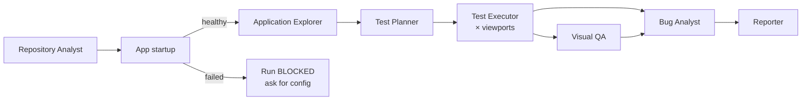

# AI agent workflow

> Status: **design** — agents are implemented in Phases 2–5. Phase 1 ships the data model
> (`AgentExecution`, `TestCase`, `Bug`, …), the queue topology (`packages/shared/src/queues.ts`)
> and the worker process that will host the processors.

## Principles

1. **Structured outputs only.** Every agent returns JSON validated against a Zod schema before
   it is persisted. Invalid output is retried, never stored as-is.
2. **Shared execution state.** Agents communicate through the database (`TestRun`,
   `AgentExecution.output`, `TestCase`, `Screenshot`, …), not by passing prompts to each other.
   Each stage can be re-run from the persisted state of the previous one.
3. **Evidence before claims.** A bug is only recorded when a test execution produced evidence
   (failed assertion, screenshot, console/network error). Agent opinions without evidence are
   stored as *recommendations*, not bugs. Visual findings carry a `confidence` and a flag
   distinguishing objective defects from subjective design suggestions.
4. **No fabricated success.** If the application cannot be started, a run becomes `BLOCKED`
   with the reason and logs. If an agent fails, its `AgentExecution` is `FAILED` and the run
   reports it.
5. **Least privilege.** Agents never see platform secrets. Customer test credentials are
   decrypted only inside the browser worker that needs them and are redacted (via
   `redact(…, knownSecrets)`) from logs, prompts, screenshots metadata and reports.
6. **Traceability.** Model id, token usage, duration and errors are recorded per agent call
   and roll up into `UsageRecord` for billing and cost monitoring.

## Pipeline

| Agent | Queue | Input | Output (persisted) | Tools |
|---|---|---|---|---|
| Repository Analyst | `tp-repo-analysis` | Cloned repo (read-only), file tree, manifests | `Repository.analysis`: framework, package manager, routes, components, env vars referenced, start/build commands, testing hints | File read/search (sandboxed), Claude |
| App startup | `tp-app-startup` | Analysis, project env vars | Health status, URL inside sandbox network, startup logs | Sandbox exec with CPU/memory/time limits |
| Application Explorer | `tp-exploration` | App URL, test credentials | Page map, forms, interactive elements, user journeys, initial screenshots | Playwright, DOM + accessibility tree snapshots, Claude |
| Test Planner | `tp-test-generation` | Analysis + exploration map + project test settings | `TestCase` rows (ID, name, category, priority, preconditions, steps, expected result, data, viewport) | Claude |
| Test Executor | `tp-test-execution` | Test cases × viewports | `TestExecution`, `TestStep`, screenshots, video, console + network logs | Playwright (Chromium; Firefox/WebKit later) |
| Visual QA | `tp-visual-analysis` | Screenshots per viewport, baseline | Annotated screenshots, findings with severity + confidence + objective/subjective flag | Claude vision, pixel diff |
| Bug Analyst | `tp-bug-analysis` | Failed executions + evidence | `Bug` rows with repro steps, expected/actual, suggested fix, fingerprint | Claude |
| Reporter | `tp-report-generation` | Everything above | HTML + PDF `Report` artifacts | Templating, headless Chromium PDF |

## Viewports

Defined once in `packages/shared/src/viewports.ts`: Desktop 1920×1080, Laptop 1366×768,
Tablet 768×1024, Mobile 390×844, Mobile 360×800. Projects choose a subset in their test settings.

## Regression tracking (Phase 6)

Each bug gets a stable `fingerprint` (normalized page + component + failure signature). When a
new run completes, bugs are classified as *new*, *still present* or *resolved* by comparing
fingerprints with the previous run on the same branch.
