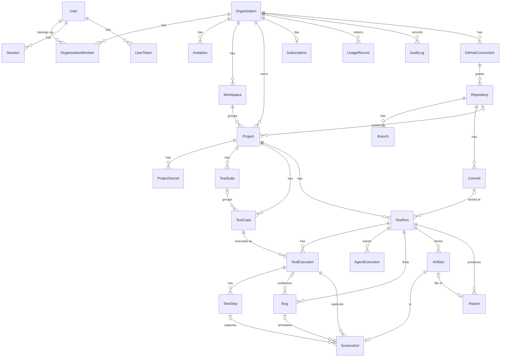

# Database design

PostgreSQL 14+ via Prisma. Source of truth: `packages/database/prisma/schema.prisma`.
Migrations: `packages/database/prisma/migrations`.

## Conventions

- **UUID primary keys** generated by PostgreSQL (`gen_random_uuid()`).
- **snake_case** tables and columns; camelCase in TypeScript.
- **Tenant ownership:** every tenant-owned row has `organization_id`, either directly
  (projects, test runs, bugs, artifacts, reports, secrets, usage, audit logs, repositories,
  GitHub connections) or through a parent that has it (test cases → project, executions → run).
  API queries always filter by the caller's organization.
- **Timestamps:** `created_at` everywhere; `updated_at` on mutable rows.
- **Emails** are `citext` (case-insensitive uniqueness).
- **Secrets and tokens are never stored in plaintext:** session/verification/reset/invite tokens
  are stored as SHA-256 hashes; project secrets and GitHub tokens are AES-256-GCM envelopes.
- **Cascades:** deleting an organization deletes all its data. Deleting a project deletes its
  runs, cases, bugs, reports and secrets. Users referenced as creators are `RESTRICT`.

## Entity relationship diagram



## Models

| Model | Purpose | Notable columns / constraints |
|---|---|---|
| `User` | Account | `email` citext unique, `password_hash` (scrypt, nullable for OAuth-only users), `email_verified_at` |
| `Session` | Server-side session | `token_hash` unique, `active_organization_id`, `expires_at` (indexed), `last_seen_at` |
| `UserToken` | Email verification / password reset | `purpose`, `token_hash` unique, `expires_at`, `consumed_at` (single use) |
| `Organization` | Tenant | `slug` unique |
| `OrganizationMember` | Membership + role | unique `(organization_id, user_id)`, `role` enum OWNER/ADMIN/DEVELOPER/VIEWER |
| `Invitation` | Pending invite | `token_hash` unique, `status`, `expires_at` (7 days) |
| `Workspace` | Project grouping inside an org | unique `(organization_id, slug)`, one `is_default` |
| `Project` | Application under test | unique `(organization_id, slug)`, `status` ACTIVE/ARCHIVED, `test_settings` JSON (validated by `testSettingsSchema`) |
| `ProjectSecret` | Env vars & test credentials | unique `(project_id, kind, key)`, `encrypted_value` (AES-GCM envelope), optional `hint` |
| `GitHubConnection` | GitHub App installation / OAuth grant | `installation_id`, `encrypted_access_token`, `revoked_at` |
| `Repository`, `Branch`, `Commit` | Source metadata | unique `(organization_id, external_id)`, `analysis` JSON (Repository Analyst output) |
| `TestSuite`, `TestCase` | Generated tests | unique `(project_id, key)` e.g. `TC-0042`; `category`, `priority`, `steps` JSON, `viewport` |
| `TestRun` | One execution of a suite | unique `(project_id, number)`, `status`, `trigger`, counters, `blocked_reason`, `retry_of_id` |
| `TestExecution`, `TestStep` | Per-case / per-step results | status, duration, console logs, network errors |
| `Bug` | Confirmed defect | unique `(project_id, key)`, `severity`, `confidence`, `fingerprint` (cross-run regression matching) |
| `Artifact`, `Screenshot` | Evidence files in object storage | `storage_key` unique (`test-results/{project}/{run}/{folder}/{file}`), viewport, annotations |
| `Report` | HTML/PDF report | linked artifact, JSON summary |
| `AgentExecution` | Agent trace | agent type, model, input/output tokens, structured output, error |
| `Subscription` | Plan state | `plan`, `status`, provider ids (Stripe) |
| `UsageRecord` | Metering | metric enum, quantity, indexed by `(organization_id, metric, occurred_at)` |
| `AuditLog` | Security log | actor, action, target, redacted metadata, IP |

## Indexes

Every foreign key used for tenant-scoped listing is indexed, e.g. `projects(organization_id,
status)`, `test_runs(organization_id, created_at)`, `test_runs(project_id, status)`,
`bugs(organization_id, status, severity)`, `audit_logs(organization_id, created_at)`,
`sessions(expires_at)` for cleanup.

## Transactions

Multi-row invariants are written in a single transaction: organization creation (org + owner
membership + default workspace + subscription + session switch), invitation acceptance,
password reset (consume token + update hash + revoke sessions), member removal (+ clearing
active-org pointers), organization deletion.

## Migrations

```bash
pnpm db:migrate        # apply (prisma migrate deploy) — used in CI/production
pnpm db:migrate:dev    # create a new migration from schema changes (development)
pnpm --filter @testpilot/database migrate:status
```

The initial migration enables the `citext` extension (a trusted extension; the database owner
can create it).
