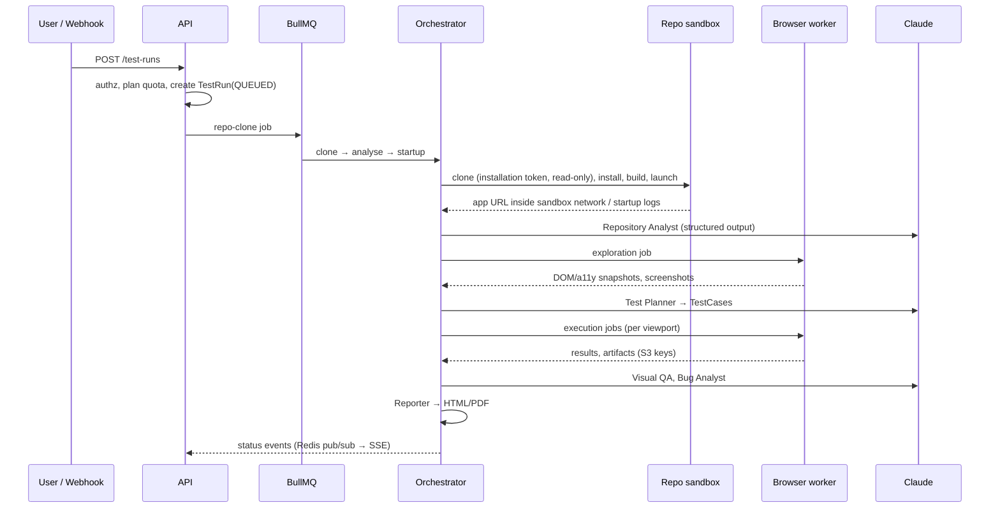

# System design

TestPilot AI is a multi-tenant SaaS that connects to a customer's GitHub repository, understands
the web application in it, and tests it autonomously with AI agents driving a real browser.
This document describes the target architecture and marks what exists today.

> Status legend: **[built]** implemented and tested · **[phase N]** designed, scheduled for phase N.

## 1. Components

```mermaid
flowchart TB
  subgraph Browser
    UI[Next.js web app]
  end
  subgraph Control plane (trusted)
    WEB[apps/web<br/>Next.js server]
    API[apps/api<br/>Fastify REST API]
    PG[(PostgreSQL)]
    REDIS[(Redis / BullMQ)]
    S3[(S3-compatible<br/>artifact storage)]
    ORCH[Agent orchestrator<br/>apps/worker]
  end
  subgraph Execution plane (untrusted code)
    BW[Browser workers<br/>Playwright + Chromium]
    SANDBOX[Repo sandbox<br/>clone · install · launch]
  end
  CLAUDE[Anthropic Claude API]
  GH[GitHub App / webhooks]

  UI -- same-origin /api/v1 --> WEB -- rewrite --> API
  API --> PG
  API -- enqueue --> REDIS
  REDIS --> ORCH
  ORCH --> PG
  ORCH -- jobs --> BW
  ORCH -- jobs --> SANDBOX
  ORCH --> CLAUDE
  BW --> S3
  API -- signed URLs --> S3
  GH -- webhooks --> API
  ORCH -- installation tokens --> GH
```

| Component | Path | Responsibility | Status |
|---|---|---|---|
| Web app | `apps/web` | Next.js 15 App Router UI. Proxies `/api/v1/*` to the API so the session cookie is first-party and no CORS is needed. | **[built]** |
| REST API | `apps/api` | Authentication, tenancy, RBAC, projects, secrets, invitations, billing state, integrations status, audit log. Single source of authorization. | **[built]** |
| Worker | `apps/worker` | BullMQ consumers. Phase 1 runs the `system` queue and a health endpoint; pipeline processors are added per phase. | **[built]** (system queue) |
| Database | `packages/database` | Prisma schema, migrations, client, seed. | **[built]** |
| Shared | `packages/shared` | Zod schemas, RBAC matrix, plan catalogue, queue topology, crypto, SSRF guard, redaction, DTO types. | **[built]** |
| UI kit | `packages/ui` | shadcn-style components on Radix + Tailwind v4, design tokens (light/dark). | **[built]** |
| Testing | `packages/testing` | In-process API test harness, DB reset, fake DNS, cookie-jar client. | **[built]** |
| Repo sandbox | — | Clone, install, build, launch customer apps in isolation. | [phase 2–3] |
| Browser workers | — | Playwright execution, screenshots, video, console/network capture. | [phase 4] |
| Agents | — | Analyst, Explorer, Planner, Executor, Visual QA, Bug Analyst, Reporter. | [phase 2–5] |

## 2. Request flow (built)

1. The browser calls `https://app/api/v1/...` with the `tp_session` cookie and the
   `x-testpilot-csrf: 1` header on mutations.
2. Next.js rewrites the request to the API service (`API_URL`).
3. The API (Fastify): helmet headers → rate limit → CSRF check → session lookup (SHA-256 of the
   cookie token) → route handler.
4. Tenant-scoped handlers call `requireOrg(request, permission)`, which re-reads the membership
   for the active organization on **every** request and checks the permission matrix.
5. All tenant data queries include `organizationId` from that context; resources from another
   tenant return `404` (indistinguishable from non-existent).
6. Mutations of interest write an `audit_logs` row with redacted metadata.

## 3. Test-run pipeline (target design)



Every stage is a separate queue (`packages/shared/src/queues.ts`) with its own concurrency,
retry/backoff and timeout policy. Each stage writes an `AgentExecution` row (model, tokens,
structured output, error) so runs are traceable and resumable.

If application startup fails or configuration is missing, the run is marked **BLOCKED** with a
reason; it is never reported as passed.

## 4. Real-time updates (phase 4)

Workers publish run events to Redis; the API exposes `GET /api/v1/test-runs/:id/events` as
Server-Sent Events, authorised like any other tenant read. SSE is preferred over WebSockets: it
is one-directional, works through the Next.js proxy and needs no sticky sessions.

## 5. Key decisions

| Decision | Rationale |
|---|---|
| Separate Fastify API instead of Next.js route handlers | Keeps the authorization boundary in one service that workers, webhooks and future clients share; Next.js stays a UI. |
| First-party sessions instead of Auth.js | The API (not Next.js) is the security authority. Opaque DB-backed sessions give instant revocation (logout everywhere, member removal, password reset) and are simple to audit. GitHub OAuth sign-in is added in Phase 2 on the same session model. |
| Session cookie + custom CSRF header | SameSite=Lax cookie, plus a header that cross-site forms cannot set and an Origin allow-list. |
| scrypt (Node built-in) for passwords | Memory-hard, no native add-on to build in containers. Parameters are stored per hash for future upgrades. |
| AES-256-GCM with key ids + AAD for secrets | Supports rotation; AAD binds ciphertext to its project/key so rows cannot be swapped. |
| Prisma + PostgreSQL, UUIDs generated in DB | Strong relational model for tenancy; `citext` for case-insensitive emails. |
| BullMQ queue per pipeline stage | Independent scaling and failure isolation; browser workers can run on separate hosts. |
| pnpm monorepo, packages consumed as TypeScript source | No package build step in development; API/worker are bundled with tsup for production; Next.js transpiles packages. |
